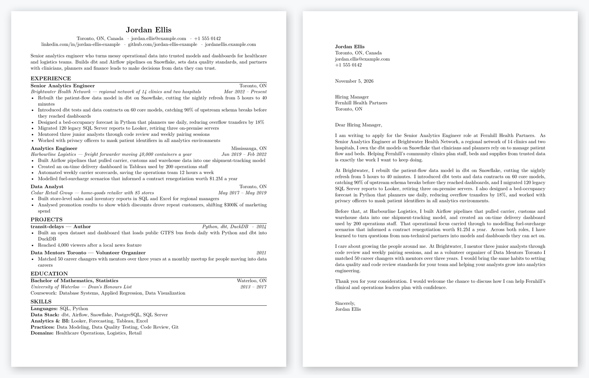
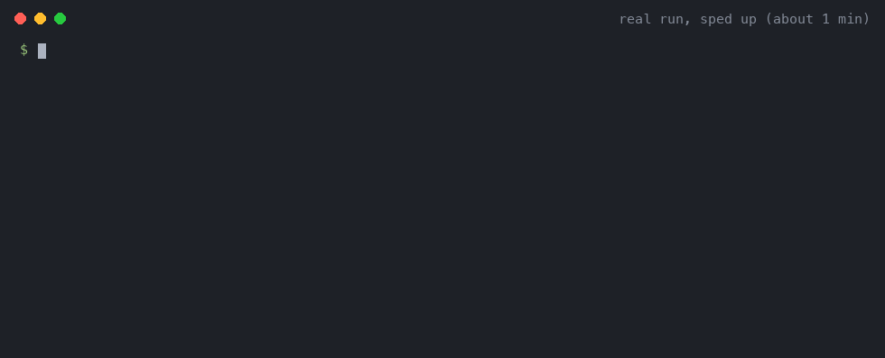

# Resume Toolkit

[](https://github.com/shottah/resume-toolkit/actions/workflows/test.yml)

**A tailored resume and cover letter for every job, written by
Claude Code from your own career history, and never padded with things you
haven't done.**

Write your career history once, as YAML. Point the tool at a job description
and Claude writes a tailored resume and cover letter in LaTeX, which
[tectonic](https://tectonic-typesetting.github.io/) compiles to PDF. Before
it writes anything, it scores how well the job fits your experience and lists
the gaps.



## Why it's different

- **It never invents experience.** Every fact comes from your own YAML files.
  If it isn't in `source/`, it isn't on the page.
- **It tells you when a job isn't a fit.** Each job gets a 1–10 fit score and
  a list of the must-haves you can't show, before any time goes into writing.
- **The right length, ATS-friendly.** One page by default, two for a long
  career if you choose, and it warns when a document runs over. Single column,
  standard fonts, clean LaTeX you can edit.
- **It can't run commands on your machine.** Claude works with a restricted
  toolset and no shell, so a hostile job posting can't make it do anything.
- **Your data stays yours.** Your profile and applications are git-ignored;
  only the tool is shared.



## What you need

- [Claude Code](https://docs.claude.com/en/docs/claude-code/overview), so the
  `claude` command is on your `PATH` and signed in
- [tectonic](https://tectonic-typesetting.github.io/) (`brew install tectonic`
  or `cargo install tectonic`)
- `make` and `bash` (already on macOS and most Linux systems)

## Get your own copy

Click **Use this template** at the top of this page and create a new
repository from it (private is a good choice), then clone it. Your profile
and applications are git-ignored either way, so they never leave your
machine. To try it without a GitHub account, a plain `git clone` of this
repository works too.

## Try it

The repo ships with a made-up person and a sample job, so you can see the
whole flow before adding anything of your own:

```
make application JD=example/job-description.md
```

On the first run there is no `source/` folder yet, so the tool copies the
example profile from `example/source/` into `source/` and tells you so. It
then creates `applications/YYYY-MM-<company>-<role>/` with the job
description, a `notes.md` holding the fit score, and the compiled
`out/resume.pdf` and `out/cover-letter.pdf`.

## Use it inside Claude Code

Open Claude Code in your copy of the repo and use the two built-in commands:

```
/fit https://example.com/jobs/senior-analytics-engineer
/apply applications/2026-11-acme-corp-senior-analytics-engineer
```

- `/fit <job link or file>` scores the job against your profile and lists the
  gaps, without writing any documents. Give it an application folder instead
  to re-check that job against your current profile.
- `/apply <job link, file, or folder from /fit>` writes the tailored resume and
  cover letter and tells you where the PDFs are.

Both run the same scripts as `make`. Your Claude Code session never reads the
job posting itself: the restricted Claude does that, and your session only
sees a short summary.

## Make it yours

Edit the files in `source/`:

| File | What goes in it |
|---|---|
| `profile.yaml` | name, contact details, a short summary, and optional `relocation` places |
| `experience.yaml` | each role, with every highlight worth mentioning, plus tags |
| `education.yaml` | degrees and courses |
| `skills.yaml` | skills grouped by category |
| `projects.yaml` | projects outside or alongside your jobs |

Write down more than fits on one page. Claude picks the most relevant
highlights for each job, so a fuller `source/` gives better results. It
never invents facts: if something isn't in `source/`, it won't appear.

If you're moving, list the places under `relocation` in `profile.yaml`
(there's a commented example). Your resume always shows your real location;
for a job in one of those places it adds "Relocating to <place>", and the
cover letter repeats your `work_authorization` statement word for word. It
never says anything about relocation or visas that `profile.yaml` doesn't.

Resumes are one page by default. With a long history, add this line to
`source/preferences.yaml` to allow two:

```yaml
resume_pages: 2
```

Claude then uses two full pages, keeping page 1 strong enough to stand on its
own. Cover letters always stay on one page.

Any other file you add to `source/`, such as `certifications.yaml`, is read
as more facts. The one exception is `preferences.yaml`: put your own rules
there, such as titles you never use, claims to avoid, or what to emphasize.
Claude follows those as rules and never quotes them.

`source/` and `applications/` are git-ignored, so your data stays on your
machine even if you push changes to the tool.

## Commands

```
make application  JD=<path-or-url>                    # create a folder, check the fit, write both documents
make resume       DIR=<app-dir> [JD=<path-or-url>]    # rewrite the resume only
make cover-letter DIR=<app-dir> [JD=<path-or-url>]    # rewrite the cover letter only
make fit          DIR=<app-dir>                       # re-check the fit after editing source/
make pdf          TEX=<file.tex>                      # compile one .tex file
make test                                             # run the script tests
make help                                             # show this list
```

`JD=` takes a local markdown file or an `http(s)://` URL. A URL is fetched
once and saved to `<DIR>/job-description.md`, so later runs can leave `JD=`
out.

## The fit check

`make application` first scores the job against `source/` from 1 to 10.
Claude lists the job's requirements before it looks at your profile, splits
them into blocking (required, or a hard bar such as years or work
authorisation) and nice to have, then scores how many of the blocking ones
you cover. Missing items don't each cost a fixed number of points. It writes
four lines to `notes.md`:

- `fit_score`: 9–10 means every blocking requirement is covered, 7–8 means
  at most one is missing, 4–6 about half, 1–3 most.
- `fit_gaps`: the blocking requirements your `source/` doesn't cover.
- `fit_minor_gaps`: the nice-to-haves it doesn't cover.
- `fit_confidence`: `high`, `medium` or `low`, depending on how clear the
  job description is.

Below 7 it prints a warning and carries on. After you add experience to
`source/`, `make fit DIR=<app-dir>` re-checks an existing application and
updates only those four lines. If you can't honestly bridge the gap, press
Ctrl-C to stop before the documents are written. Often the fix is adding
real experience to `source/` that you had left out.

## Checks after each build

Every time a PDF is built, `scripts/check.sh` looks for three common problems
and prints a warning for each one it finds. It never stops the build:

- the document runs past one page (two for a resume when `resume_pages: 2`
  is set), or, if `pdftotext` is installed, a two-page resume's second page
  is mostly empty;
- a stock phrase such as "proven track record" or "spearheaded" appears that
  your own `source/` doesn't use (the list is in `scripts/stock-phrases.txt`);
- a number such as "40%", "$1.2M", "3x" or "12 engineers" appears that isn't
  in `source/`.

Read them as prompts to look again, not as errors: a number can be fine if
you worked it out from your own facts.

## Changing how Claude writes

The instructions Claude follows are plain text in `scripts/prompts/`:
`tailor.md` writes the resume and cover letter (with `rules-resume.md` and
`rules-cover-letter.md` for rules that apply to only one of them),
`scaffold.md` creates the application folder, and `fit-rules.md` holds the
fit-scoring rules. The layout and styling come from
`templates/resume.tex` and `templates/cover-letter.tex`. Edit any of them in
your own fork to change tone, length, emphasis or design.

## Safety

Claude runs with a restricted toolset (`Read, Write, Edit, WebFetch, Glob,
Grep`) and no shell access. A job description fetched from the web can't make
it run commands on your machine.

## License

[MIT](LICENSE)

Some writing and fit-scoring ideas were inspired by
[career-ops](https://github.com/career-ops-hq/career-ops).
